# Recognising Kenyan Sign Language with Deep Learning

**Can a computer recognise Kenyan Sign Language (KSL) from an ordinary phone photo, and does deep learning beat classic machine learning at it?**

This project trains and compares **12 models**: 8 classic machine-learning models and 4 deep convolutional neural networks. They all use the same **6,238 photos of nine everyday KSL signs**. It also explains what the best model looks at, and presents everything in an interactive dashboard.

**Term paper · DSA 4050-XA Deep Learning · United States International University–Africa (Fall 2026)**
Selmah Tzindori (669602) · Lecturer: Dr. Alex Wambua

| | |
|---|---|
| 🔗 **Live dashboard** | [ksl-recognition.streamlit.app](https://ksl-recognition.streamlit.app) |
| 📄 **Report** (PDF, 1,795 words) | [`report/KSL_Term_Paper_Selmah_Tzindori.pdf`](report/KSL_Term_Paper_Selmah_Tzindori.pdf) |
| 🎞️ **Slides** (PDF, 24 slides) | [`slides/KSL_Presentation_Slides_Selmah_Tzindori.pdf`](slides/KSL_Presentation_Slides_Selmah_Tzindori.pdf) |
| 📓 **Notebooks** (Google Colab) | [`notebooks/`](notebooks/) |

---

## Results at a glance

| | Best classic model<br>(HOG + SVM) | Best deep model<br>(EfficientNetB0, 3-stage fine-tuning) |
|---|---|---|
| **Test accuracy** (941 unseen photos) | 60.0% | **86.0%** |
| **95% confidence interval** | 57.1–63.2% | 82.7–87.2% |
| **Macro-F1** | 0.603 | **0.859** |
| **Top-2 accuracy** | – | **94.7%** |
| **Rotated 30°** | 17.0% (near random) | **74.2%** |

- **Deep learning wins clearly.** Every deep model beats every classic model. The best is **+25.9 percentage points** ahead, and the confidence intervals do not overlap. Random guessing scores **11.1%**.
- **It looks at the hands.** Grad-CAM heatmaps show the network relies on hands and fingers, not backgrounds, clothing or faces.
- **It knows when it is unsure.** With a 0.80 confidence threshold, the model answers 79% of photos with **95.9% accuracy**. Otherwise it says "not sure".
- **Weak spot: heavy blur** (−17.6 points), because the model relies on fine finger detail.

---

## Table of contents

1. [Project overview](#1-project-overview)
2. [Why deep learning](#2-why-deep-learning)
3. [Dataset](#3-dataset)
   - [3.1 Source and data mining](#31-source-and-data-mining)
   - [3.2 What the data contains](#32-what-the-data-contains)
   - [3.3 Exploratory data analysis](#33-exploratory-data-analysis)
   - [3.4 Cleaning](#34-cleaning)
   - [3.5 Preprocessing and data split](#35-preprocessing-and-data-split)
4. [Methods](#4-methods)
   - [4.1 Classic machine learning](#41-classic-machine-learning)
   - [4.2 Deep learning](#42-deep-learning)
   - [4.3 Data augmentation](#43-data-augmentation)
   - [4.4 Evaluation protocol](#44-evaluation-protocol)
5. [Results](#5-results)
   - [5.1 All twelve models](#51-all-twelve-models)
   - [5.2 Key patterns](#52-key-patterns)
   - [5.3 Per-sign performance](#53-per-sign-performance)
   - [5.4 Where the mistakes are](#54-where-the-mistakes-are)
   - [5.5 What the model looks at: Grad-CAM](#55-what-the-model-looks-at-grad-cam)
   - [5.6 Confidence: knowing when it does not know](#56-confidence-knowing-when-it-does-not-know)
   - [5.7 Robustness to real-world photos](#57-robustness-to-real-world-photos)
   - [5.8 Training curves](#58-training-curves)
6. [Interactive dashboard](#6-interactive-dashboard)
7. [Limitations and future work](#7-limitations-and-future-work)
8. [Conclusion](#8-conclusion)
9. [Repository structure](#9-repository-structure)
10. [How to reproduce](#10-how-to-reproduce)
11. [Technology stack](#11-technology-stack)
12. [Glossary](#12-glossary)
13. [References](#13-references)
14. [Licence and acknowledgements](#14-licence-and-acknowledgements)

---

## 1. Project overview

**The problem.** Kenyan Sign Language is the language of Kenya's Deaf community. The Constitution of Kenya (2010, Art. 7(3)(b)) commits the State to promoting its development and use. Yet few hearing Kenyans understand KSL, so communication in clinics, schools and offices still depends on scarce interpreters. Almost everyone carries a phone, so a model that recognises signs from a phone photo is a realistic first step towards learning apps and assistive tools.

**The goal.**
1. Recognise **nine everyday KSL signs** from ordinary photographs: *Church, Enough/Satisfied, Friend, Love, Me, Mosque, Seat, Temple, You*.
2. Test the **hypothesis** that, on identical data, deep learning clearly outperforms classic machine learning that relies on hand-crafted features.

**How the term paper requirements are covered**

| Requirement | Where in this project |
|---|---|
| (a) Choose an area and justify why deep learning is appropriate | [Section 2](#2-why-deep-learning), report §1 |
| (b) Mine an appropriate dataset (presented to the class) | [Section 3](#3-dataset), notebooks 01–03 |
| (c) Train ML models and compare them on accuracy | [Sections 4–5](#4-methods), notebooks 04–06 |
| (d) Build an interactive dashboard | [Section 6](#6-interactive-dashboard), [`dashboard/`](dashboard/) |
| Write-up (max 2,000 words) | [`report/`](report/) (1,795 words) |

**The pipeline**

```
 Mine data ──► Explore ──► Clean & prepare ──► Classic ML ──┐
 (Kaggle API)  (EDA)       (crop, split)                     ├──► Evaluate ──► Dashboard
                                          └──► Deep learning ┘    (CIs, Grad-CAM,  (Streamlit)
                                                                   robustness)
```

---

## 2. Why deep learning

This is a problem where deep learning is justified, not just fashionable, for three reasons:

1. **Huge variation, tiny differences.**
   - Photos differ completely in signer, skin tone, clothing, background, lighting and camera angle.
   - Two signs may differ only in an open versus a closed hand, or a finger position.
   - Hand-crafted features such as HOG respond to *every* edge, including patterned clothing. A convolutional neural network (CNN) **learns which visual patterns matter** directly from labelled examples.
2. **Transfer learning makes small data viable.**
   - Networks pretrained on ImageNet (1.3 million photos; Deng et al., 2009) already detect edges, textures, skin and finger-like shapes.
   - About 4,400 training photos are therefore enough to adapt them. Training a deep network from nothing would need far more.
3. **Decisions can be inspected.** Grad-CAM (Selvaraju et al., 2017) shows *where* a CNN looks. We can check that it reads the hands rather than shortcuts such as the background or the image shape.

---

## 3. Dataset

### 3.1 Source and data mining

| | |
|---|---|
| **Original source** | [Kenyan Sign Language Classification Challenge](https://zindi.africa/competitions/kenyan-sign-language-classification-challenge), Zindi Africa |
| **Accessed via** | Kaggle re-upload [KSLC Dataset](https://www.kaggle.com/datasets/awsaf49/kslc-dataset) by awsaf49 |
| **How** | Zindi no longer allows downloads, so the data was downloaded with the **Kaggle API** (`kagglehub`) straight into Google Colab and backed up to Google Drive (1.19 GB) |
| **Integrity check** | All 8,931 files opened and checked: **0 missing, 0 corrupt** |
| **Licence** | None stated on Kaggle, so both sources are credited. The dataset is **not** stored in this repository. |

The download contained **6,249 labelled images** and **2,679 unlabelled competition test images**. The competition images were excluded because their labels were never released.

### 3.2 What the data contains

- **9 signs, perfectly balanced:** 694–695 images each, so **random guessing scores 11.1%** (1 in 9). That is the floor every model must beat.
- **Torso-framed phone photos** taken at home: 720×1280 portrait (79%) or 1280×720 landscape (21%), with faces mostly out of frame.

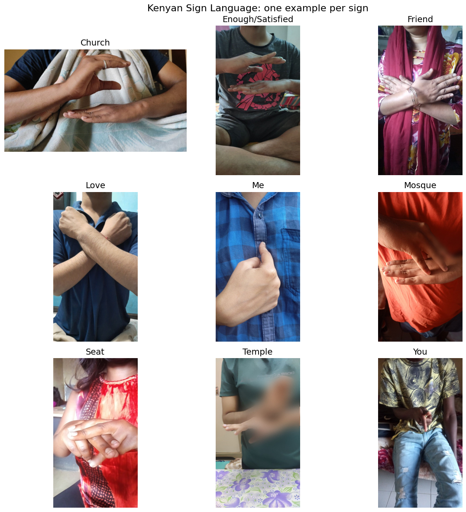

### 3.3 Exploratory data analysis

Exploration produced four findings that shaped every later step.

| Finding | What we saw | What we did |
|---|---|---|
| **Orientation shortcut** | The share of landscape photos varies by sign, from 15.3% (*Church*) to 28.4% (*Love*). A model could partly guess the sign from the image shape. | Centre-crop every image to a **square** (§3.5) |
| **No quality shortcut** | Median brightness (105–109), contrast (51–55) and sharpness are almost identical across signs. | Nothing needed |
| **Same signers across signs** | 0 exact duplicates and only **25 near-duplicate images (0.4%)** in 9 small groups, found with perceptual hashing (dHash, ≤ 6 of 64 bits different). The groups revealed the **same person, in the same room, performing different signs**. | Group-aware split (§3.5); signer overlap noted as a limitation (§7) |
| **Look-alike signs** | *Friend* and *Love* both cross the arms; *Church*, *Enough/Satisfied* and *Mosque* all use flat, stacked hands. | Predicted where models would struggle, which was confirmed in §5.4 |

**Average image of each sign.** All ~690 photos of a sign are averaged. Backgrounds blur away and only the typical hand position remains, which shows how subtle the differences are.

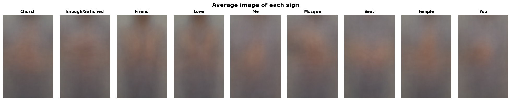

<details>
<summary><b>More EDA figures</b> (class balance, orientation, quality, near-duplicates, blur)</summary>

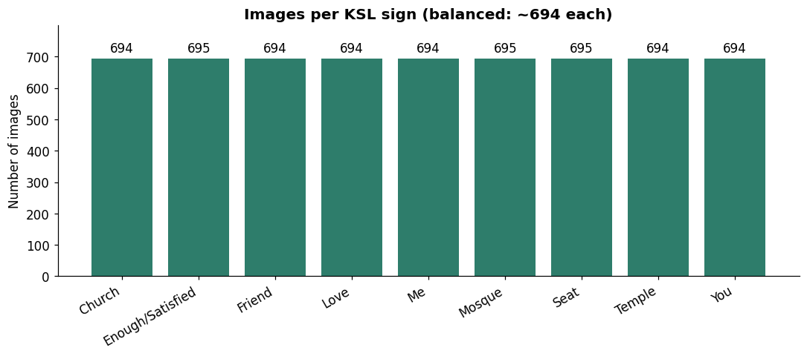
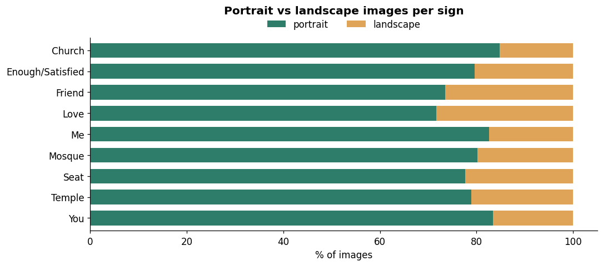
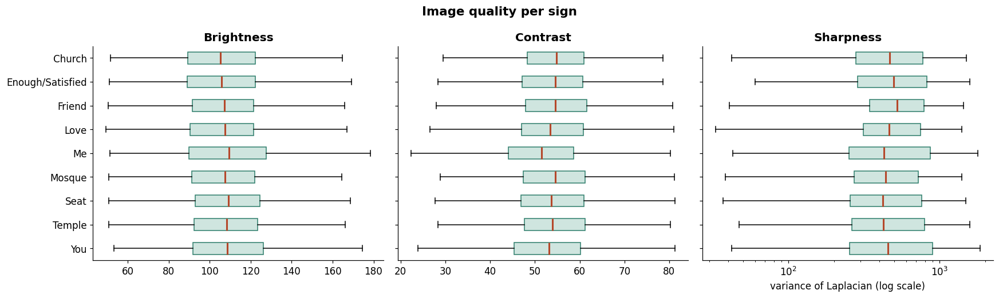
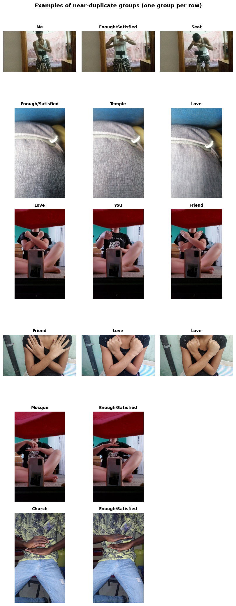
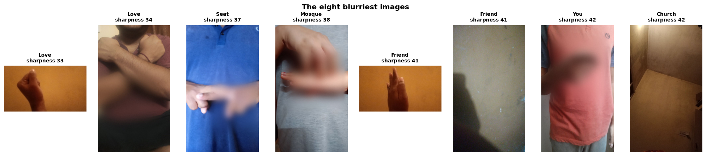
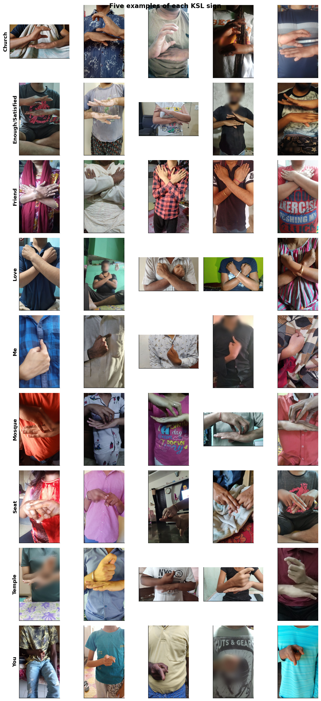

</details>

### 3.4 Cleaning

Some photos showed **no sign at all**: blank surfaces, floors, fabric, a street at night. They were removed in two steps.

1. **Automatic screen.** Every sign is made with bare hands, so each image was converted to the **YCrCb colour space**, where skin tones fall in a compact range, and scored by its share of skin-coloured pixels in the centre.
2. **Manual review.** The **48 lowest-scoring images** were checked by eye. **8** showed no sign, plus **3** near-duplicate copies of one of them, so **11 images were removed (0.2%)**, leaving **6,238**.

> **A bias lesson.** The fixed skin-colour rule **under-detected the hands of darker-skinned signers**: clearly visible hands scored as "no skin". This is a known weakness of hand-written colour rules, so every removal was decided by a person. It is also an argument for learning features from diverse data instead of writing rules by hand.

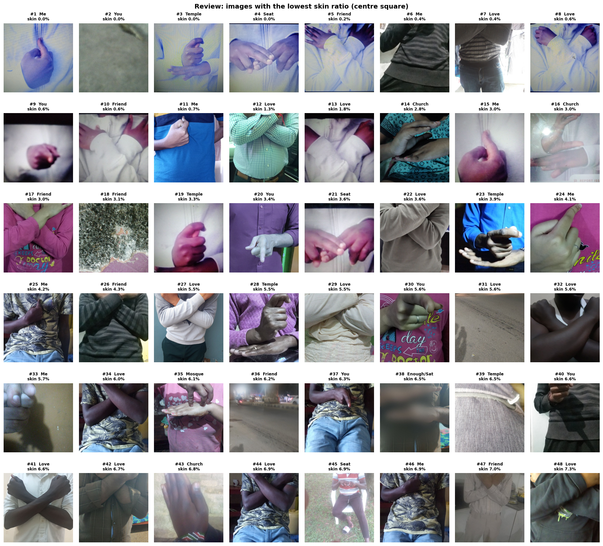

### 3.5 Preprocessing and data split

**Preprocessing.**
- Every image is **centre-cropped to a square** and **resized to 224×224 RGB**, the input size of the pretrained networks.
- The square crop removes the orientation shortcut.
- In portrait photos it removes the head and legs (no sign information) and makes the hands larger.
- In a few landscape photos part of a hand near the edge is cut, which is noted as a limitation.

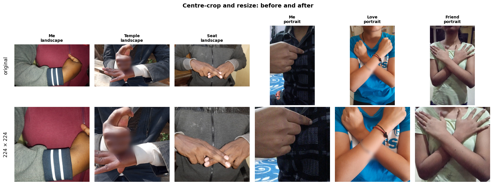

**Split: 70 / 15 / 15**, which is

- **stratified**: every sign has the same share in each set;
- **group-aware**: near-duplicate groups never cross sets, so there is no leakage from copies.

| Set | Images | Per sign | Used for |
|---|---|---|---|
| Train | 4,362 | 483–487 | Fitting model weights |
| Validation | 935 | 103–104 | Choosing settings, early stopping, picking the best model |
| Test | 941 | 103–105 | Final evaluation, used **once** per model |

**Fair comparison:** all 12 models use exactly the same split, and settings were chosen on the validation set only.

| Property | Value |
|---|---|
| Signs (classes) | 9, balanced (691–695 each after cleaning) |
| Images used | 6,238 (11 invalid removed) |
| Model input | Centre square crop, 224 × 224 RGB |
| Random seed | 42, for the whole project |

---

## 4. Methods

### 4.1 Classic machine learning

Classic algorithms cannot read photos directly, so each photo is first turned into a list of numbers (**features**). Colour is dropped on purpose: EDA showed colour mostly reflects clothing and background.

| Feature set | How it is made | Values per image |
|---|---|---|
| **Raw pixels** | 32×32 greyscale image, flattened | 1,024 |
| **HOG** (Histogram of Oriented Gradients; Dalal & Triggs, 2005) | 64×64 greyscale image in 8×8-pixel cells; each cell records the direction of its edges (9 orientation bins), normalised over neighbouring blocks. It captures outlines of arms and hands. | 1,764 |

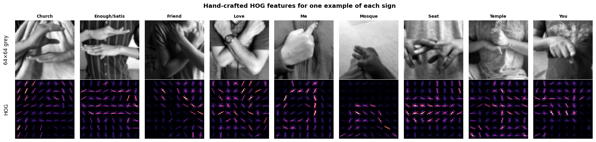

Each feature set is **standardised** and compressed with **PCA to 150 components**, then classified by four algorithms. Each setting is tuned on the validation set, and the best setting is evaluated once on the test set.

| Classifier | Idea | Settings tried | Best |
|---|---|---|---|
| Logistic Regression | Linear boundaries between classes | C ∈ {0.01, 0.1, 1} | C = 0.01 |
| SVM (RBF kernel) | Flexible, curved boundaries | C ∈ {1, 10} | C = 10 |
| Random Forest | 300 decision trees voting | max depth ∈ {None, 20} | None |
| k-Nearest Neighbours | Label of the most similar training images | k ∈ {3, 7, 15} | k = 15 |

### 4.2 Deep learning

Three architectures were trained in **TensorFlow/Keras** on a Colab **T4 GPU**.

| Model | Description | Weights | Training |
|---|---|---|---|
| **CNN from scratch** | 4 blocks of two 3×3 convolutions each (32 → 64 → 128 → 256 filters), each with batch normalisation and ReLU, followed by max-pooling. Then global average pooling, dropout 0.4 and a 9-way softmax | 1.18M | Up to 60 epochs, learning rate 1e-3 (≈ 42 min) |
| **MobileNetV2** (Sandler et al., 2018) | ImageNet-pretrained, designed for phones | 2.27M | 2 stages (≈ 7.5 min) |
| **EfficientNetB0** (Tan & Le, 2019) | ImageNet-pretrained, more accurate design | 4.06M | 2 stages (≈ 10 min) + an extended 3rd stage (≈ 10 min) |

**Transfer learning in stages**
1. **Feature extraction.** The pretrained base is **frozen**, and only a new head (pooling → dropout → 9-way dense layer) is trained, at learning rate 1e-3. Validation accuracy plateaued around **68–74%**: generic ImageNet features alone are not enough.
2. **Fine-tuning.** The **top 40 layers** are unfrozen and trained with a very small learning rate (**1e-5**), so the pretrained features adapt gently to hand signs. Batch-normalisation layers stay frozen. This added **12–16 points**.
3. **Extended fine-tuning** (EfficientNetB0 only). Its curves were still rising with no sign of overfitting, so the **top 100 layers** were unfrozen for up to 40 more epochs. Validation accuracy went from 86.4% to **89.0%**, and test accuracy from 84.9% to **86.0%**.

**Training helpers** (all models):
- **Early stopping**: keep the best weights by validation accuracy.
- **Learning-rate reduction** when progress stalls.
- **Checkpoints** saved to Google Drive.
- The best deep model was chosen by **validation** accuracy, never test accuracy.

### 4.3 Data augmentation

Every training image is **randomly altered every epoch**, so the network never sees exactly the same picture twice. Augmentation runs only during training. Validation, test and dashboard predictions use the unaltered image.

| Augmentation | Setting | Imitates |
|---|---|---|
| Horizontal flip | 50% chance | Left-handed signers |
| Rotation | ±10° | A tilted phone |
| Zoom | ±15% | Phone closer or further away |
| Translation | ±10% | Signer off-centre |
| Brightness and contrast | ±20% | Different lighting |

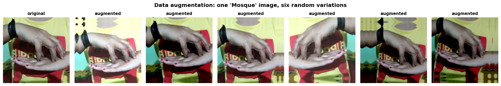

### 4.4 Evaluation protocol

| Measure | What it tells us |
|---|---|
| **Test accuracy** | Share of the 941 unseen test photos classified correctly |
| **Macro-F1** | F1 (balance of precision and recall) averaged equally over the 9 signs |
| **95% bootstrap confidence intervals** | The test set resampled **2,000 times**; the middle 95% of scores gives the likely range (Efron & Tibshirani, 1993) |
| **Top-2 accuracy** | The true sign is among the model's two most likely signs |
| **Confusion matrices** | Which signs are mixed up with which |
| **Grad-CAM** | Which image regions drove each prediction |
| **Confidence analysis** | Whether the model is more confident when it is right |
| **Robustness tests** | Accuracy on test photos altered by blur, darkness, rotation and noise |

---

## 5. Results

### 5.1 All twelve models

Sorted by test accuracy:

| Model | Type | Train acc. | Validation acc. | **Test acc.** | Macro-F1 | Training time | Prediction | Weights |
|---|---|---|---|---|---|---|---|---|
| **EfficientNetB0 (extended fine-tuning)** | Deep | 95.8% | 89.0% | **86.0%** | **0.859** | +10 min* | 7.0 ms | 4.06M |
| EfficientNetB0 | Deep | 90.4% | 86.4% | 84.9% | 0.849 | 10 min | 8.0 ms | 4.06M |
| CNN from scratch | Deep | 93.3% | 85.8% | 84.3% | 0.843 | 42 min | 5.4 ms | 1.18M |
| MobileNetV2 | Deep | 93.4% | 84.4% | 81.6% | 0.817 | 7.5 min | 4.2 ms | 2.27M |
| HOG + SVM (RBF) | Classic | 100% | 63.4% | 60.0% | 0.603 | 20 s | 1.4 ms | – |
| HOG + k-NN | Classic | 64.3% | 58.4% | 55.8% | 0.558 | 1 s | 0.1 ms | – |
| HOG + Logistic Regression | Classic | 62.4% | 54.0% | 52.3% | 0.524 | 3 s | < 0.1 ms | – |
| HOG + Random Forest | Classic | 100% | 56.5% | 51.8% | 0.516 | 19 s | 0.2 ms | – |
| Raw pixels + SVM (RBF) | Classic | 99.7% | 37.9% | 35.0% | 0.352 | 26 s | 1.1 ms | – |
| Raw pixels + k-NN | Classic | 38.9% | 30.5% | 27.5% | 0.271 | 1 s | 0.2 ms | – |
| Raw pixels + Random Forest | Classic | 100% | 30.7% | 26.8% | 0.262 | 26 s | 0.2 ms | – |
| Raw pixels + Logistic Regression | Classic | 28.0% | 18.1% | 20.6% | 0.203 | 2 s | < 0.1 ms | – |

\* Extra stage only, after the 10-minute EfficientNetB0 run. Prediction time is per image on a T4 GPU (deep) or CPU (classic). Random-guess baseline: **11.1%**.

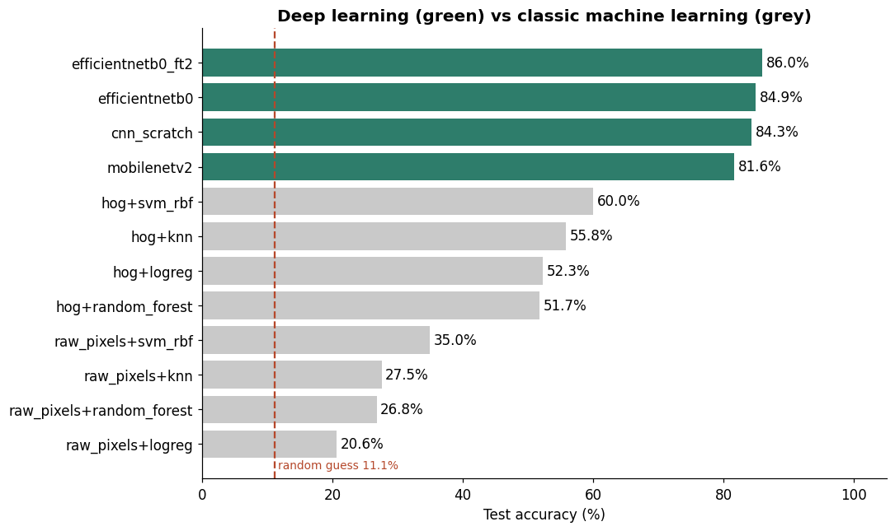

### 5.2 Key patterns

1. **Deep learning wins clearly.** All four deep models (81.6–86.0%) beat all eight classic models (≤ 60.0%). The best gain is **+25.9 points**, and the 95% confidence intervals do not overlap: deep 82.7–87.2% versus classic 57.1–63.2%. The gap is not an artefact of which photos ended up in the test set.
2. **Features matter more than the classifier.** HOG beats raw pixels by **20–32 points** with every algorithm. Raw pixels with Logistic Regression (20.6%) barely beat random guessing.
3. **Classic models memorise.** SVM and Random Forest reach **100% training accuracy** but only 52–60% on unseen photos (overfitting). Augmentation kept the deep models' train–test gap near 9–10 points.
4. **Pretraining needs fine-tuning.** Frozen ImageNet features plateau at 68–74% on validation. Unfreezing the top layers adds 12–16 points.
5. **A CNN from scratch is surprisingly competitive** (84.3% with the fewest weights). But it needed about **4× longer to train** than the transfer-learning models and had not fully converged after 60 epochs.
6. **Practical trade-off.** MobileNetV2 is the smallest and fastest pretrained model (81.6%, 4.2 ms per image), the natural choice for an on-phone app. EfficientNetB0 is the most accurate.

> **Note on 86.0% vs 85.0%.** Re-evaluating the best model in notebook 06 with the image decoder the dashboard uses (Pillow instead of TensorFlow) gave **85.0%** instead of 86.0%. That is a difference of 9 of 941 images, well within the confidence interval. The confidence intervals, robustness tests and per-sign figures come from the 85.0% run, which is why the report quotes **85–86%**.

### 5.3 Per-sign performance

Deep learning improved **every sign**, by +0.15 to +0.31 F1. The largest gains are for signs defined by finger positions that HOG could not capture.

| Sign | F1 classic | F1 deep | Gain | Precision (deep) | Recall (deep) |
|---|---|---|---|---|---|
| Church | 0.54 | 0.77 | +0.23 | 0.77 | 0.77 |
| Enough/Satisfied | 0.55 | 0.86 | **+0.31** | 0.86 | 0.87 |
| Friend | 0.60 | 0.78 | +0.17 | 0.81 | 0.74 |
| Love | 0.60 | 0.78 | +0.19 | 0.75 | 0.82 |
| Me | 0.64 | **0.91** | +0.27 | 0.90 | 0.91 |
| Mosque | 0.74 | 0.89 | +0.15 | 0.90 | 0.89 |
| Seat | 0.61 | **0.91** | **+0.30** | 0.92 | 0.90 |
| Temple | 0.56 | 0.88 | **+0.31** | 0.91 | 0.85 |
| You | 0.58 | 0.88 | **+0.30** | 0.84 | 0.91 |

- **Easiest now:** Seat, Me and Mosque.
- **Hardest:** Church, Friend and Love, the look-alike signs from EDA.

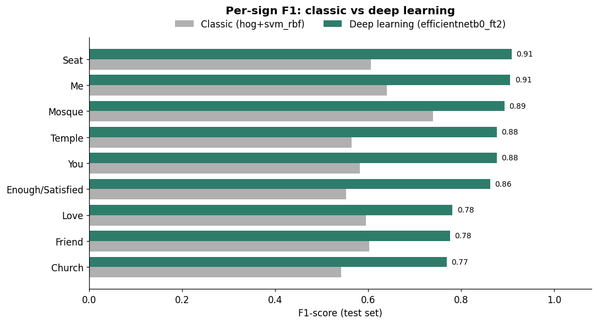

### 5.4 Where the mistakes are

Normalised confusion matrices, with rows as the true sign and columns as the prediction. The deep model's diagonal (correct answers) is much brighter: 0.74–0.91 per sign versus 0.54–0.68 for the classic model.

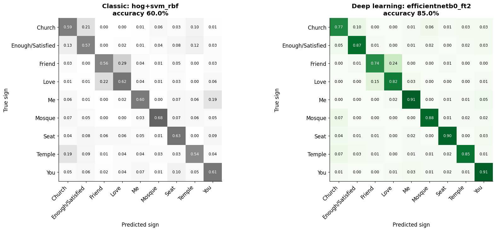

| Most common confusion (true → predicted) | Classic | Deep | Verdict |
|---|---|---|---|
| Friend → Love | 28.6% | 23.8% | Still the hardest pair: crossed arms, open hands vs fists |
| Love → Friend | 22.3% | 14.6% | Improved |
| Church → Enough/Satisfied | 21.2% | 9.6% | Largely fixed |
| Temple → Church | 19.0% | 6.7% | Largely fixed |
| Mosque → Church | 6.7% | 6.7% | Not improved: one hand resting on the other |

**Probable label noise.** Several of the model's *most confident* "mistakes" look like the **predicted** sign rather than the labelled one, for example photos labelled *Church* that show the *Mosque* hand shape. In those cases the model may be right and the label wrong, so the reported accuracy is probably slightly **conservative**. This cannot be confirmed without Deaf signers checking the labels.

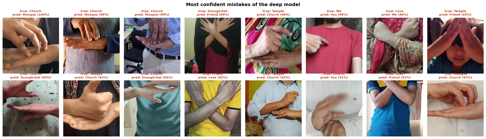

### 5.5 What the model looks at: Grad-CAM

Grad-CAM weights the last convolutional feature maps by how strongly they push the model towards its prediction, and overlays the result as a heatmap (**red = most influential**).

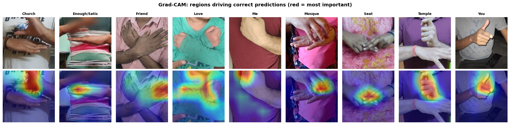

- **The heat sits on the hands and fingers:** stacked palms for *Church* and *Enough/Satisfied*, interlocked fingers for *Seat* and *Mosque*, the raised thumb for *You*, peaked fingers for *Temple*.
- **Backgrounds, clothing patterns and faces are mostly ignored.** The model learned the signs, not shortcuts.
- **Even on mistakes it looks at the hands** but reads them as a similar sign. Errors come from fine shape ambiguity (or wrong labels), not from looking in the wrong place.

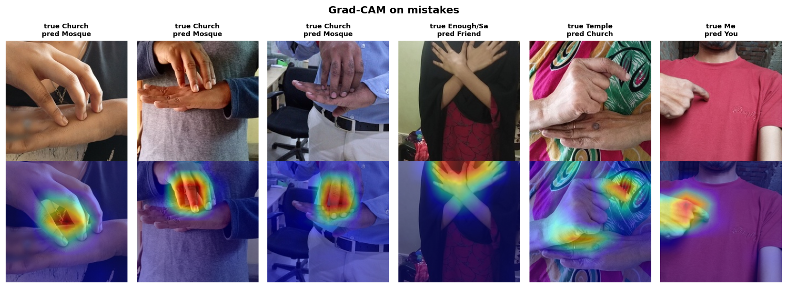

### 5.6 Confidence: knowing when it does not know

| Measure | Value |
|---|---|
| Median confidence when **correct** | **0.99** |
| Median confidence when **wrong** | **0.62** |
| Accuracy at confidence ≥ 0.80 | **95.9%**, answering 78.6% of photos |
| Top-2 accuracy | **94.7%** |

Confidence separates right from wrong answers well. The dashboard uses a **0.80 threshold**: below it, the app says *"Not sure, please try again"* instead of guessing.

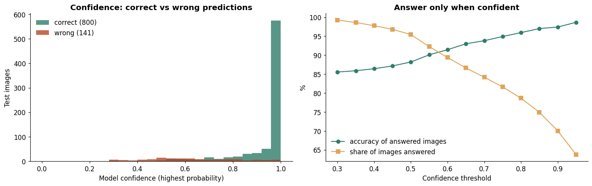

### 5.7 Robustness to real-world photos

No photos from new signers were available, so the **test photos were altered on purpose** to imitate what real users might produce.

| Condition | Imitates | Deep | Classic |
|---|---|---|---|
| Original | – | **85.0%** | 60.0% |
| Blur, radius 2 | Shaky hands | 83.5% | 60.5% |
| Blur, radius 4 | Out of focus | **67.4%** (−17.6) | 56.8% |
| Darkness × 0.6 | Dim room | 85.3% | 60.9% |
| Darkness × 0.35 | Very dim room | 83.6% | 61.0% |
| Rotation 15° | Tilted phone | 81.0% | 44.4% |
| Rotation 30° | Strongly tilted phone | **74.2%** | **17.0%** (near random) |
| Noise σ = 15 | Grainy camera | 84.5% | 60.3% |
| Noise σ = 30 | Very grainy camera | 76.8% (−8.2) | 59.8% |

- **Darkness barely matters**, thanks to brightness augmentation.
- **Rotation is where deep learning shines.** The classic model collapses at 30°; the deep model keeps 74%.
- **Heavy blur is the deep model's weak spot**, because it relies on fine finger detail. HOG barely changes because it already works on a coarse 64×64 greyscale image. Practical advice: hold the phone steady.

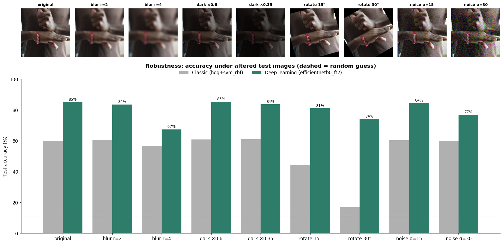

### 5.8 Training curves

The best model's training and validation curves stay close together, with no harmful overfitting. The dotted line marks the start of the extended fine-tuning stage.

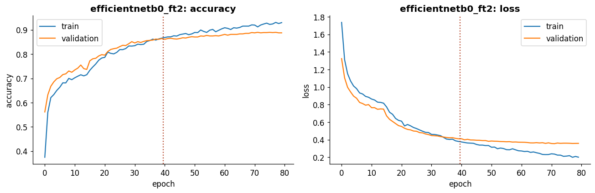

<details>
<summary><b>Training curves of the other deep models</b></summary>

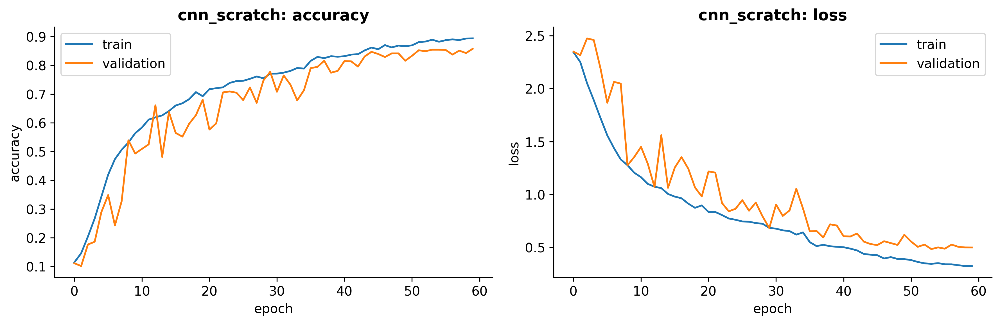
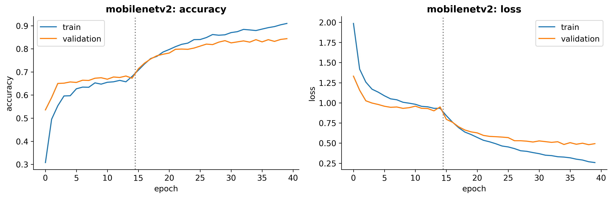
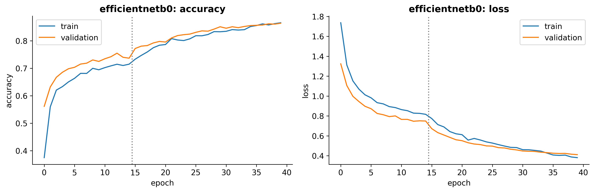

</details>

---

## 6. Interactive dashboard

🔗 **[ksl-recognition.streamlit.app](https://ksl-recognition.streamlit.app)**. Free Streamlit apps sleep when unused. If you see *"This app has gone to sleep"*, click the button and wait about a minute.

| Page | What it does |
|---|---|
| 🏠 **Overview** | The problem, key numbers and the pipeline |
| 📊 **Dataset** | Example photos per sign, average images, class balance, image quality and the cleaning funnel |
| 🏆 **Model showdown** | Interactive leaderboard of all 12 models, overfitting and size–speed charts, per-sign F1, confusions and training curves |
| 📷 **Try it live** | Classify an example, uploaded or **webcam** photo. Shows the probabilities, applies the 0.80 confidence threshold and overlays Grad-CAM |
| 🌪️ **Stress test** | Sliders blur, darken, rotate or add noise to a photo while **both** models re-predict live |

**Tip for "Try it live":** frame your chest and hands in the centre, in good light, and keep still. That matches how the training photos were taken.

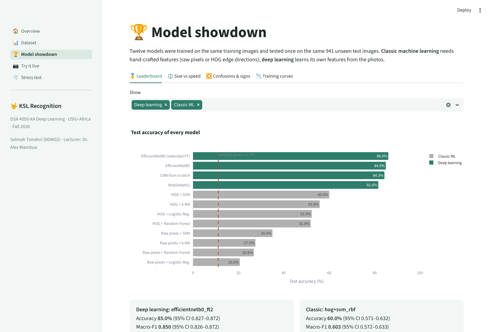

The dashboard is self-contained: the two trained models (`dl_best.keras`, `classic_best.pkl`), example photos, results tables and figures are all in [`dashboard/assets/`](dashboard/assets/). See [How to reproduce](#10-how-to-reproduce) to run it locally.

---

## 7. Limitations and future work

| Limitation | Why it matters | Next step |
|---|---|---|
| **Only 9 static signs** | Real KSL is continuous, with movement and facial expression | Video or pose-based models (hand landmarks over time) |
| **Signer overlap** | No signer IDs, so the same people may appear in training and test sets, which can inflate accuracy | A signer-independent test set, ideally collected with the Deaf community |
| **Label noise** | Some labels appear wrong; none were verified by Deaf signers | Labels verified with the Deaf community |
| **Blur sensitivity** | Heavy blur costs 17.6 points | Stronger blur and noise augmentation before real use |
| **Square crop** | Occasionally cuts part of a hand in landscape photos | Hand detection to crop around the hands |

---

## 8. Conclusion

On identical data, deep learning recognised nine KSL signs from everyday phone photographs with **85–86% accuracy**, against **60%** for the best classic approach. That is a statistically clear gain of about 26 points, so the hypothesis holds.

- Transfer learning with fine-tuning gave the best results in a fraction of the training time.
- The network's attention falls on the hands.
- Its confidence can flag uncertain cases.

The main obstacles to real-world use are now **data rather than models**: more signs, signer-independent evaluation, motion, and labels verified by Deaf signers.

---

## 9. Repository structure

```
ksl-recognition/
├── README.md                  this file
├── LICENSE.txt                MIT licence (code)
├── notebooks/                 Colab notebooks 00–06, run in order (outputs and findings saved)
│   ├── 00_project_setup.ipynb … 06_evaluation.ipynb
│   └── _TEMPLATE.ipynb        starting template for new notebooks
├── src/
│   └── ksl_utils.py           shared helpers used by every notebook
├── dashboard/                 Streamlit app
│   ├── app.py                 entry point (sidebar navigation)
│   ├── home.py                Overview page
│   ├── pages/                 Dataset, Model showdown, Try it live, Stress test
│   ├── utils.py               model loading, prediction, Grad-CAM, image alterations
│   ├── requirements.txt
│   ├── .streamlit/config.toml theme and upload limit
│   └── assets/                trained models, example photos, results tables and figures
├── outputs/figures/           figures produced by the notebooks (used in this README)
├── report/                    term paper (Word + PDF)
├── slides/                    presentation (PDF)
└── data/                      placeholder; the dataset lives on Google Drive
```

### Notebooks

| # | Notebook | What it does | Main outputs | Part |
|---|---|---|---|---|
| 00 | [`00_project_setup`](notebooks/00_project_setup.ipynb) | Creates the Drive folders, writes the helper module, checks the GPU, logs the environment | Project folders, `ksl_utils.py` | – |
| 01 | [`01_data_collection`](notebooks/01_data_collection.ipynb) | Downloads the dataset with the Kaggle API, checks every file, builds the image catalogue | Raw data on Drive, catalogue | (b) |
| 02 | [`02_eda`](notebooks/02_eda.ipynb) | Class balance, orientation, image quality, near-duplicates (dHash), average images | EDA figures, enriched catalogue | (b) |
| 03 | [`03_preprocessing`](notebooks/03_preprocessing.ipynb) | Skin-colour screen + manual review, centre crop to 224×224, stratified group-aware split | Clean 224×224 dataset, `catalogue_split.csv` | (b) |
| 04 | [`04_classic_ml`](notebooks/04_classic_ml.ipynb) | Raw-pixel and HOG features × 4 classifiers, tuned on validation | `classic_best.pkl`, results | (c) |
| 05 | [`05_deep_learning`](notebooks/05_deep_learning.ipynb) | CNN from scratch, MobileNetV2, EfficientNetB0 (+ extended fine-tuning), augmentation | `dl_best.keras`, training curves | (c) |
| 06 | [`06_evaluation`](notebooks/06_evaluation.ipynb) | Confidence intervals, confusion matrices, per-sign F1, confidence, Grad-CAM, robustness | Evaluation figures and tables | (c) |

Every notebook follows the same structure: objective → inputs/outputs → numbered sections → an **interpretation** after each result → **findings for the report**. Every figure, table and metric is saved automatically, so the report numbers trace back to a notebook.

### Helper module: `src/ksl_utils.py`

| Function | Purpose |
|---|---|
| `make_folders()` | Create the project folders on Google Drive |
| `restore_raw_data()`, `restore_processed_data()` | Copy the zipped data from Drive to fast local disk and unzip it |
| `load_split_catalogue()`, `load_class_names()` | Load the image catalogue with the train/validation/test split |
| `set_seed()` | Fix all random seeds (42) for reproducibility |
| `save_figure()`, `save_table()` | Save figures (300 dpi) and tables with captions, logged per notebook |
| `log_result()`, `load_results()` | Record key numbers in `results.json` for the report |
| `log_experiment()` | Add one row per trained model to `experiments.csv` (classic and deep in one table) |
| `save_history()`, `plot_history()` | Save and plot training curves |
| `project_summary()` | Print a status summary of everything produced so far |

---

## 10. How to reproduce

### A. Run the notebooks (Google Colab)

**Requirements:** a Google account (Colab + Drive) and a free [Kaggle](https://www.kaggle.com) account.

1. **Kaggle API token.** On Kaggle, go to *Settings → API → Create New Token*. In Colab, open the 🔑 **Secrets** panel, add a secret named **`KAGGLE_API_TOKEN`** with the token, and allow notebook access. The token never appears in the notebooks or on GitHub.
2. **Open [`notebooks/00_project_setup.ipynb`](notebooks/00_project_setup.ipynb) in Colab**, select a **T4 GPU** runtime (*Runtime → Change runtime type*) and run it once. It creates `MyDrive/DSA4050/ksl-recognition/` and the helper module.
3. **Run notebooks 01 → 06 in order.** Each starts with a standard setup cell that mounts Google Drive and imports `ksl_utils.py`.

The longest step is notebook 05: about **70 minutes** on a T4 for all four networks (CNN from scratch ≈ 42 min, MobileNetV2 ≈ 7.5 min, EfficientNetB0 ≈ 10 min + 10 min extended fine-tuning). Notebook 05 skips any model that is already saved on Drive, so it can be resumed after a disconnect.

Data, models and outputs are saved to Google Drive, so a Colab disconnect does not lose work. Seeds are fixed at 42. GPU training is not bit-for-bit deterministic, so re-runs can differ by a few images.

### B. Run the dashboard locally

Requires **Python 3.10–3.13**. TensorFlow does not support Python 3.14; on Windows, `py -3.10` (or `-3.11`, …) selects a compatible version.

```bash
git clone https://github.com/SelmahT/ksl-recognition.git
cd ksl-recognition/dashboard
python -m venv .venv
.venv\Scripts\activate          # Mac/Linux: source .venv/bin/activate
pip install -r requirements.txt
streamlit run app.py
```

The app opens at `http://localhost:8501`. The trained models are already in `dashboard/assets/models/`, so no training is needed.

### C. Deploy the dashboard (Streamlit Community Cloud)

At [share.streamlit.io](https://share.streamlit.io), create an app from this repository with **main file path `dashboard/app.py`**. Under *Advanced settings*, choose a Python version that TensorFlow supports (3.10–3.13).

---

## 11. Technology stack

| Area | Tools |
|---|---|
| Compute | Google Colab (Tesla T4 GPU), Google Drive for data and models |
| Deep learning | TensorFlow 2.21 with Keras (EfficientNetB0, MobileNetV2, custom CNN) |
| Classic ML | scikit-learn 1.6.1 (Logistic Regression, SVM, Random Forest, k-NN, PCA) |
| Image processing | OpenCV, scikit-image (HOG), Pillow; a custom difference hash (dHash) for near-duplicates |
| Data | pandas, NumPy, SciPy, kagglehub (Kaggle API) |
| Visualisation | Matplotlib, Plotly |
| Dashboard | Streamlit (deployed on Streamlit Community Cloud) |
| Environment | Python 3.13 (Colab); Python 3.10–3.13 for the dashboard |

---

## 12. Glossary

| Term | Plain-language meaning |
|---|---|
| **Accuracy** | Share of photos classified correctly |
| **Augmentation** | Randomly flipping, rotating, zooming and re-lighting training photos so the model cannot memorise them |
| **Bootstrap confidence interval** | The likely range of a score, found by resampling the test set many times (here 2,000) |
| **CNN (convolutional neural network)** | A neural network for images: early layers detect edges, later layers combine them into shapes such as fingers and hands |
| **Confusion matrix** | Table of true sign (rows) vs predicted sign (columns); the diagonal holds the correct answers |
| **Data leakage** | Test information sneaking into training (e.g. a near-copy of a test photo), which inflates the score |
| **Epoch** | One pass through all training photos |
| **F1-score** | A 0–1 score per class combining precision and recall; **macro-F1** averages it equally over all classes |
| **Fine-tuning** | Unfreezing the top layers of a pretrained network and retraining them gently with a tiny learning rate |
| **Grad-CAM** | A heatmap showing which parts of the image drove the model's decision |
| **HOG** | Histogram of Oriented Gradients: a hand-crafted feature recording edge directions in small cells |
| **Overfitting** | Memorising the training photos (high training accuracy) instead of learning the sign (low test accuracy) |
| **PCA** | Compresses many features into fewer components that keep most of the information |
| **Precision / recall** | Precision: when the model says "Love", how often it is right. Recall: of all real "Love" photos, how many it finds |
| **Stratified, group-aware split** | Every sign has the same share in each set, and near-identical photos stay in the same set |
| **Top-2 accuracy** | The true sign is among the model's two most likely answers |
| **Transfer learning** | Starting from a network already trained on millions of photos and adapting it to a new task |
| **Validation set** | Photos used to choose settings, kept separate from the final test set |

---

## 13. References

- awsaf49. (n.d.). *KSLC Dataset* [Data set]. Kaggle. https://www.kaggle.com/datasets/awsaf49/kslc-dataset
- Constitution of Kenya. (2010). Article 7(3)(b). National Council for Law Reporting.
- Dalal, N., & Triggs, B. (2005). Histograms of oriented gradients for human detection. *Proceedings of the IEEE Conference on Computer Vision and Pattern Recognition (CVPR)*, 886–893.
- Deng, J., Dong, W., Socher, R., Li, L.-J., Li, K., & Fei-Fei, L. (2009). ImageNet: A large-scale hierarchical image database. *Proceedings of the IEEE Conference on Computer Vision and Pattern Recognition (CVPR)*, 248–255.
- Efron, B., & Tibshirani, R. J. (1993). *An introduction to the bootstrap*. Chapman & Hall.
- Sandler, M., Howard, A., Zhu, M., Zhmoginov, A., & Chen, L.-C. (2018). MobileNetV2: Inverted residuals and linear bottlenecks. *Proceedings of the IEEE Conference on Computer Vision and Pattern Recognition (CVPR)*, 4510–4520.
- Selvaraju, R. R., Cogswell, M., Das, A., Vedantam, R., Parikh, D., & Batra, D. (2017). Grad-CAM: Visual explanations from deep networks via gradient-based localization. *Proceedings of the IEEE International Conference on Computer Vision (ICCV)*, 618–626.
- Tan, M., & Le, Q. V. (2019). EfficientNet: Rethinking model scaling for convolutional neural networks. *Proceedings of the 36th International Conference on Machine Learning (ICML)*, 6105–6114.
- Zindi Africa. (n.d.). *Kenyan Sign Language Classification Challenge*. https://zindi.africa/competitions/kenyan-sign-language-classification-challenge

---

## 14. Licence and acknowledgements

- **Code:** MIT licence, see [`LICENSE.txt`](LICENSE.txt).
- **Dataset:** not included in this repository. It belongs to its original sources, the Zindi KSL Classification Challenge and the Kaggle re-upload by awsaf49, which are credited above. No licence is stated on Kaggle.
- **Pretrained weights:** ImageNet weights distributed with Keras Applications.
- **Thanks** to Dr. Alex Wambua for the DSA 4050-XA Deep Learning course, and to the Kenyan Deaf community whose language this project is about.

---

*Selmah Tzindori · DSA 4050-XA Deep Learning · USIU-Africa · November 2026*